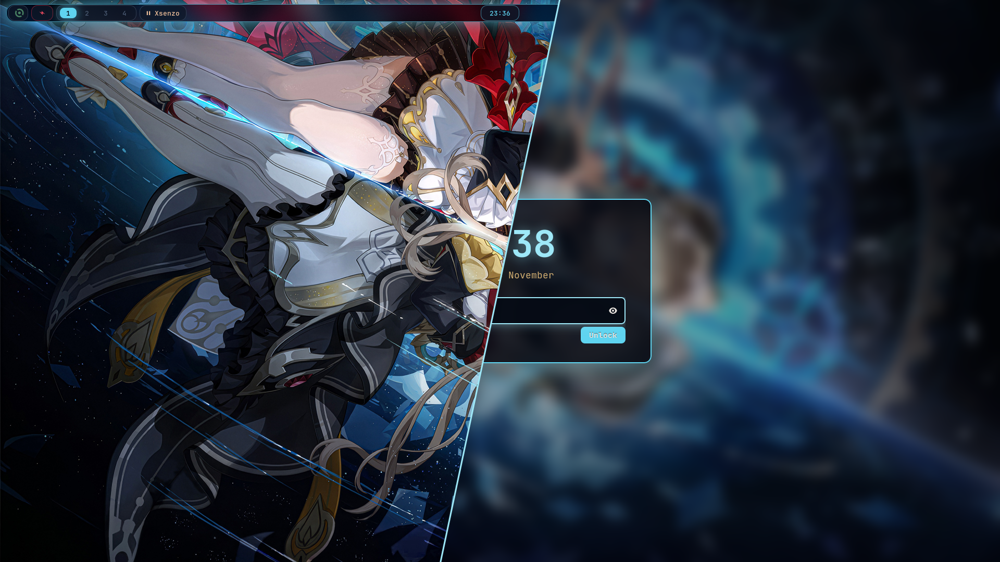

# Dots

My dotfiles, built on Void Linux and meant to work on my other distros too.

A swayfx desktop with a "Clockwork" theme pulled from the wallpaper: deep-space navy, glowing gear cyan, crimson and gold.

## Preview


## What's in it

- **swayfx** (window manager with blur, shadows and rounded corners)
- **waybar** (status bar)
- **kitty** (terminal) with an **oh-my-posh** prompt
- **fuzzel** (app launcher), **mako** (notifications), **gtklock** (lock screen)
- An optional **SDDM** login screen to match
- An optional looping **background sound** (plays only while plugged in and out of power saver)
- The **sandrone-linux** cursor (my own)

## Install

Clone it anywhere, then run the installer. It links everything into place.
On Arch, packages missing from the repos come from the AUR with yay or paru (paru gets installed if you have neither).

```sh
git clone https://github.com/doughmination/dots ~/dots
~/dots/install --dry-run   # see what it will do first
~/dots/install
```

The installer runs five scripts, and you can run any of them on its own:

| Script | What it does |
|---|---|
| `install-deps.sh` | Installs the software (add `--no-flatpak` or `--no-services` to skip those parts) |
| `install-git.sh` | Sets your git name, email and default branch (asks, or pass `--git-name=`, `--git-email=`, `--git-branch=`; `--defaults` uses User / user@example.com / main) |
| `install-assets.sh` | Installs the font and the cursor |
| `install-config.sh` | Links the configs into `~/.config` |
| `install-scripts.sh` | Links the helper scripts into `~/.local/bin` |

### Login screen (optional)

The Clockwork SDDM theme has its own script and works without the rest of the dots:

```sh
./install-sddm.sh              # install and make it the login screen
./install-sddm.sh --no-video   # still wallpaper instead of the animated one
./install-sddm.sh --uninstall  # remove it and restore your old sddm.conf
```

Or add `--with-sddm` to `./install` to get everything at once.

### Background sound (optional)

Off by default. Turn it on with `./install --with-sound`, or edit these lines in `sway/config` and reload sway:

```
set $ambient_sound on
set $ambient_volume 30
```

**Super+M** mutes it until the next reload.

Anything already in the way is renamed to `.bak-<date>`, never deleted.

## Bar controls

| Module | Left click | Middle click | Right click |
|---|---|---|---|
| Battery | Power saver on/off | Pick a power profile | Performance on/off |
| Clock | Show this month's calendar (click again to close) | | |
| Brightness | Toggle 15% / 100% | | |
| Network | Wi-Fi on/off | | Open nmtui |
| Bluetooth | Bluetooth on/off | Open bluetui | |
| Volume | Mute | Open pavucontrol | |
| CPU / RAM | Open btop | | |
| Picture icon (next to the logo) | Still / animated wallpaper (pauses in power saver or when the battery is at 20% or less) | | |
| Coffee cup | Stay awake (no auto-lock) | | |
| Moon | Night light (warm screen) | | |
| Bell | Notification list (pick one to see it again) | | Do not disturb |
| Package (shows when updates are waiting) | Run the update | | |
| REC (shows while recording) | Stop recording | | |

## Keybindings

Press **Super+/** to search every shortcut (picking one runs it). The full list:

<details>
<summary>Show all shortcuts</summary>

| Keys | Action |
|---|---|
| `Super+Return` | `kitty` |
| `Ctrl+Alt+t` | `kitty` |
| `Super+q` | `kill` |
| `Super+space` | `fuzzel` |
| `Super+f` | `firefox` |
| `Super+b` | `pkill -SIGUSR1 waybar` |
| `Super+e` | `kitty -e yazi` |
| `Super+Alt+l` | `~/.local/bin/lock-screen` |
| `Super+n` | `makoctl restore` |
| `Super+v` | `cliphist list \| fuzzel --dmenu --prompt "clip " \| cliphist decode \|...` |
| `Super+Shift+v` | `cliphist wipe` |
| `Super+slash` | `~/.local/bin/keybinds` |
| `Super+m` | `~/.local/bin/ambient toggle` |
| `Super+Shift+r` | `reload` |
| `Super+Shift+e` | `swaynag -t warning -m 'You pressed the exit shortcut. Do you really...` |
| `Ctrl+Alt+Delete` | `~/.local/bin/powermenu` |
| `Super+Left` | `focus left` |
| `Super+Down` | `focus down` |
| `Super+Up` | `focus up` |
| `Super+Right` | `focus right` |
| `Super+Shift+Left` | `move left` |
| `Super+Shift+Down` | `move down` |
| `Super+Shift+Up` | `move up` |
| `Super+Shift+Right` | `move right` |
| `Super+1` | `workspace number 1` |
| `Super+2` | `workspace number 2` |
| `Super+3` | `workspace number 3` |
| `Super+4` | `workspace number 4` |
| `Super+5` | `workspace number 5` |
| `Super+6` | `workspace number 6` |
| `Super+7` | `workspace number 7` |
| `Super+8` | `workspace number 8` |
| `Super+9` | `workspace number 9` |
| `Super+Alt+1` | `move container to workspace number 1` |
| `Super+Alt+2` | `move container to workspace number 2` |
| `Super+Alt+3` | `move container to workspace number 3` |
| `Super+Alt+4` | `move container to workspace number 4` |
| `Super+Alt+5` | `move container to workspace number 5` |
| `Super+Alt+6` | `move container to workspace number 6` |
| `Super+Alt+7` | `move container to workspace number 7` |
| `Super+Alt+8` | `move container to workspace number 8` |
| `Super+Alt+9` | `move container to workspace number 9` |
| `Super+Ctrl+Left` | `workspace prev_on_output` |
| `Super+Ctrl+Right` | `workspace next_on_output` |
| `Super+w` | `floating toggle` |
| `Super+Shift+minus` | `move scratchpad` |
| `Super+minus` | `scratchpad show` |
| `resize: Left` | `resize shrink width 10px` |
| `resize: Down` | `resize grow height 10px` |
| `resize: Up` | `resize shrink height 10px` |
| `resize: Right` | `resize grow width 10px` |
| `resize: Return` | `mode "default"` |
| `resize: Escape` | `mode "default"` |
| `Super+r` | `mode "resize"` |
| `XF86AudioRaiseVolume` | `wpctl set-volume @DEFAULT_AUDIO_SINK@ 0.05+ -l 1.5` |
| `XF86AudioLowerVolume` | `wpctl set-volume @DEFAULT_AUDIO_SINK@ 0.05- -l 1.0` |
| `XF86AudioMute` | `wpctl set-mute @DEFAULT_AUDIO_SINK@ toggle` |
| `XF86AudioMicMute` | `wpctl set-mute @DEFAULT_AUDIO_SOURCE@ toggle` |
| `Shift+XF86AudioRaiseVolume` | `wpctl set-volume @DEFAULT_AUDIO_SINK@ 0.01+ -l 1.5` |
| `Shift+XF86AudioLowerVolume` | `wpctl set-volume @DEFAULT_AUDIO_SINK@ 0.01- -l 1.0` |
| `XF86MonBrightnessUp` | `brightnessctl -q s 5%+` |
| `XF86MonBrightnessDown` | `brightnessctl -q s 5%-` |
| `Super+o` | `brightnessctl --device='tpacpi::kbd_backlight' set 1-` |
| `Super+p` | `brightnessctl --device='tpacpi::kbd_backlight' set +1` |
| `Print` | `~/.local/bin/screenshot -c` |
| `Ctrl+Shift+Print` | `~/.local/bin/screenshot -s -c` |
| `Ctrl+Print` | `~/.local/bin/screenshot` |
| `Shift+Print` | `~/.local/bin/screenshot -s` |
| `Ctrl+Alt+Print` | `~/.local/bin/screenshot -r` |
| `Super+a` | `playerctl previous` |
| `Super+d` | `playerctl next` |
| `Super+s` | `playerctl play-pause` |
| `Super+z` | `flatpak run org.equicord.equibop` |
| `Super+c` | `flatpak run com.vscodium.codium` |

Regenerate with `binaries/keybinds --markdown`.

</details>

## Tested on

- [x] Void Linux glibc
- [ ] Arch Linux
- [ ] Debian
- [ ] Ubuntu
- [ ] Fedora
- [ ] NixOS

## Credits

The wallpaper isn't mine; I found it online. Everything else, including the cursor, is mine.
